<div align="center">

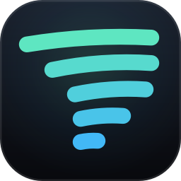

# Ventude

**Uma Dynamic Island e um shell completo para o Windows 10 e 11.**

Seus limites de IA, sua música, seu clima e sua agenda numa pílula discreta no topo da tela,
e uma nova barra de tarefas, Menu Iniciar e Pesquisa embaixo.

[](https://github.com/3Gb3/Ventude/releases/latest)
[](https://github.com/3Gb3/Ventude/releases)


[](LICENSE)

### [⬇ Baixar o Ventude para Windows](https://github.com/3Gb3/Ventude/releases/latest/download/Ventude-Setup.exe)

<sub>Grátis · instala sem administrador · atualiza sozinho</sub>

<br>

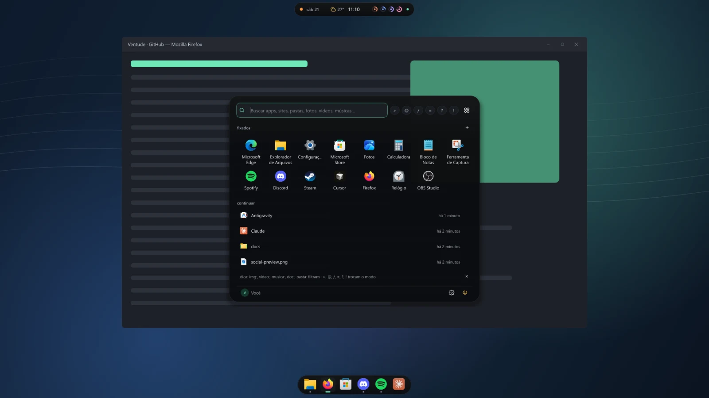

</div>

---

## Por que o Ventude?

Quem usa várias IAs no dia a dia vive abrindo abas só para descobrir quanto ainda sobra do limite. O Ventude junta tudo num lugar só, sempre à vista e sem atrapalhar:

- 🤖 **Limites de 6 IAs em tempo real** — Claude, Gemini (Antigravity), Grok, Codex (ChatGPT), Cursor e GitHub Copilot, com previsão de quando o limite acaba.
- 🏝️ **Dynamic Island no topo** — hora, música, clima, avisos e anéis de uso. Passe o mouse e ela vira um painel completo.
- 🪟 **Ventude Shell** — substitui a barra de tarefas, o Menu Iniciar e a Pesquisa do Windows por uma Doca flutuante e um Lançador rápido.
- 🔒 **Privado por padrão** — lê os limites direto das suas contas. Nada passa por servidores de terceiros e os segredos ficam protegidos pelo próprio Windows.
- ⚡ **Leve e sem configuração** — detecta as IAs instaladas, abre com o Windows e se atualiza sozinho.

## Instalação

1. Baixe o **[`Ventude-Setup.exe`](https://github.com/3Gb3/Ventude/releases/latest/download/Ventude-Setup.exe)** da [última versão](https://github.com/3Gb3/Ventude/releases/latest).
2. Abra o instalador. Ele não pede administrador, instala em `%LOCALAPPDATA%\Programs\Ventude`, cria os atalhos e já abre o Ventude.
3. Pronto. As IAs que você já usa no PC são detectadas sozinhas; as outras se ligam em **Ajustes > Limites das IAs**.

> [!NOTE]
> Como o instalador ainda não é assinado digitalmente, o Windows pode mostrar "O Windows protegeu o PC". Clique em **Mais informações > Executar assim mesmo**.

**Atualizações:** ao iniciar, o Ventude confere se há uma versão nova e pergunta se você quer atualizar. Se aceitar, ele baixa, confere o arquivo, instala em silêncio e reabre. Para conferir na hora, use **Procurar atualização** nos Ajustes.

---

## A ilha

<p align="center">
  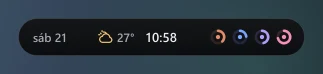
  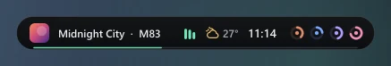
</p>
<p align="center">
  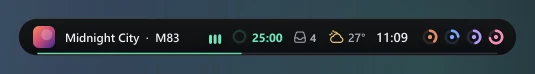
  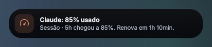
</p>
<p align="center">
  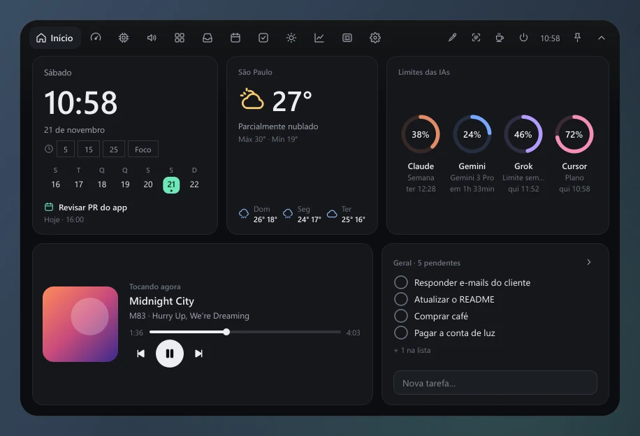
  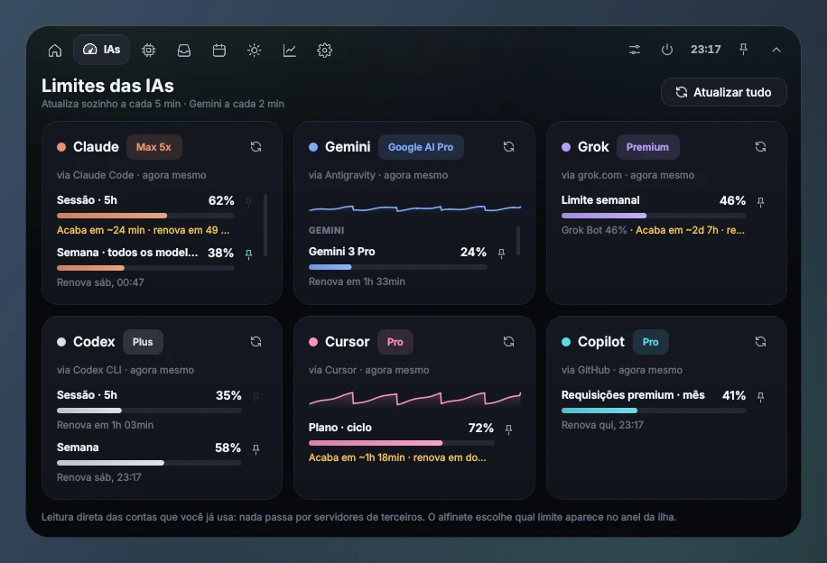
</p>

Fechada, a ilha é uma pílula com hora, clima, música e um anel por IA. Aberta, vira um painel com abas:

| Aba | O que faz |
|-----|-----------|
| **Início** | Relógio, semana, próximo compromisso, clima, anéis das IAs, player e tarefas pendentes. |
| **IAs** | Cada limite, janela por janela, com % usado, quando renova, mini-gráfico das últimas horas e previsão ("Acaba em ~1h 40min"). |
| **Sistema** | CPU (com os processos que mais usam), GPU NVIDIA, RAM, rede, disco e bateria ao vivo. |
| **Áudio** | Troca saída e microfone com 1 clique, volume master e mixer por aplicativo. |
| **Estante** | Guarda arquivos, imagens, links, textos e cores soltos na ilha, além do histórico da área de transferência. |
| **Atalhos** | Apps, pastas, arquivos e sites a um clique. Arraste do Explorer para a ilha, mesmo fechada. |
| **Agenda e Tarefas** | Calendário, compromissos com aviso 10 e 5 minutos antes, e listas rápidas. |
| **Clima** | Agora e próximos 7 dias, hora a hora, pelo Open-Meteo. |
| **Mercado e Notícias** | Ações, índices, moedas e cripto com gráfico do mês; G1, BBC Brasil e Tecnoblog. |
| **Ajustes** | Tudo salvo na hora. Abas desligadas somem e param de rodar. |

<p align="center">
  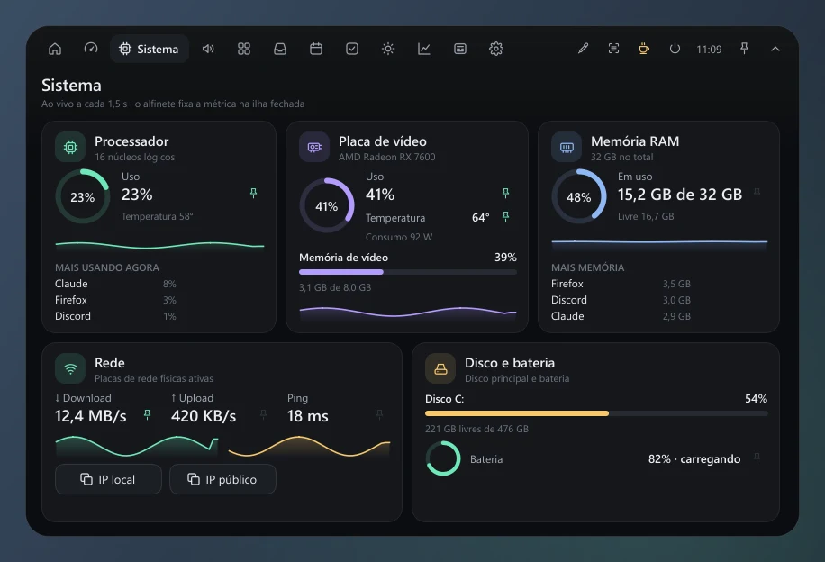
  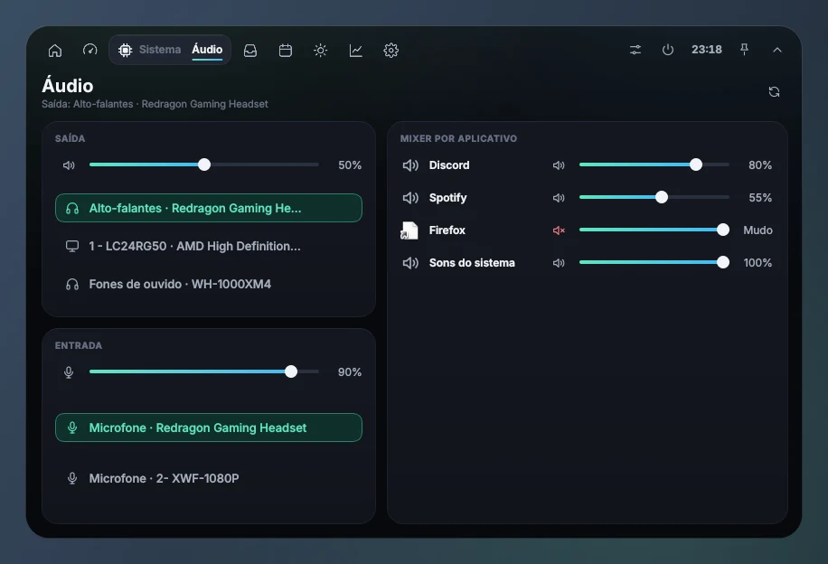
</p>
<p align="center">
  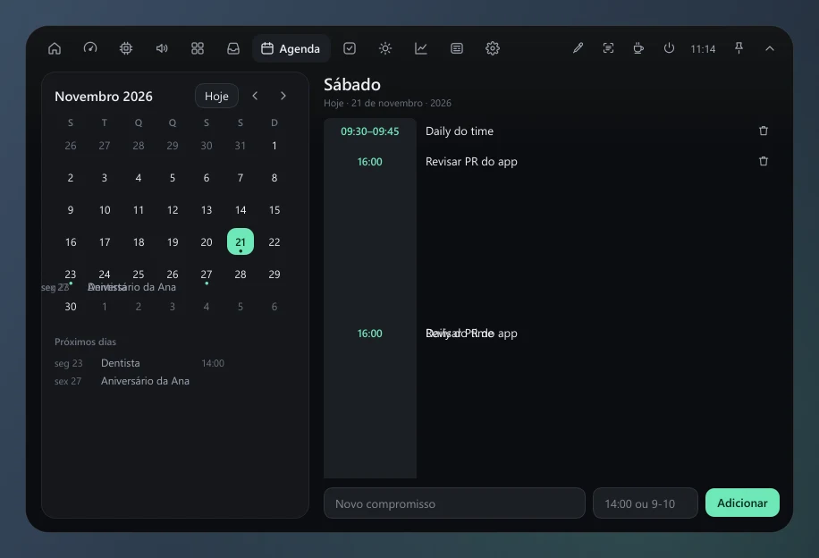
  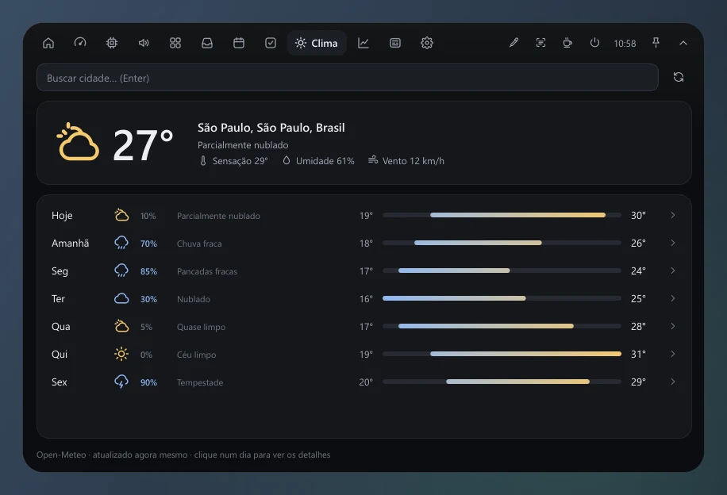
  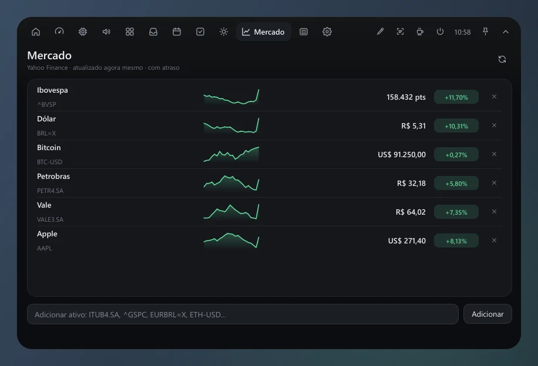
</p>
<p align="center">
  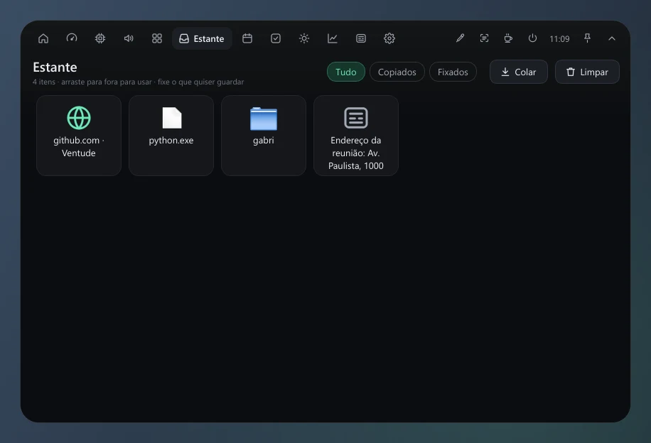
  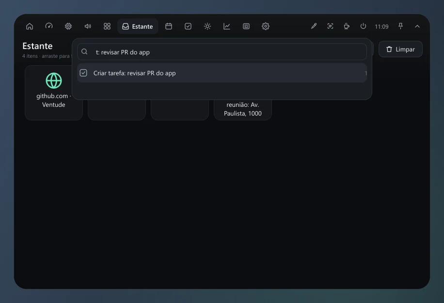
  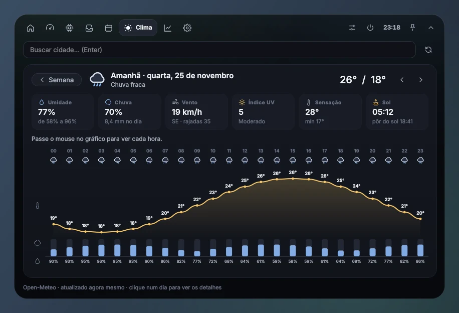
</p>

<details>
<summary><b>Ver todos os recursos da ilha</b></summary>

- **Na ilha fechada**: clique nos anéis abre as IAs, no clima abre o Clima, na data abre a Agenda. Clique do meio toca/pausa, a roda do mouse muda o volume e Shift + roda troca de faixa.
- **Avisos na própria ilha**: limites das IAs, música nova e lembretes da Agenda aparecem por alguns segundos.
- **Timer e Pomodoro**, com a contagem na ilha e um pulso ao terminar.
- **Barra de comandos** (Ctrl + K ou começar a digitar): cria tarefas (`t: revisar PR`), compromissos (`a: dentista amanhã 9h-10h`) e timers (`timer 15m`, `pomodoro`).
- **Conta-gotas** (copia a cor em HEX) e **captura de texto** (OCR do próprio Windows).
- **Busca universal**: apps (inclusive da Loja), pastas e arquivos. Entende apelidos e abreviações: `lol` acha League of Legends, `vava` o Valorant, `zap` o WhatsApp, `vsc` o Visual Studio Code. `/p nome` busca pastas, `1450 * 5,85` calcula e copia, `qr texto` gera um QR Code.
- **Modo Cafeína**: o Windows não apaga a tela nem suspende.
- **Privacidade**: ponto laranja com o microfone em uso, verde com a câmera, com o nome do app.
- **Letra sincronizada** da música (lrclib.net) e player do Spotify ou de qualquer player do Windows.
- Some sozinha em tela cheia, funciona em vários monitores e abre com **Ctrl + Alt + Espaço**.

</details>

## Ventude Shell

<p align="center">
  
</p>
<p align="center">
  
  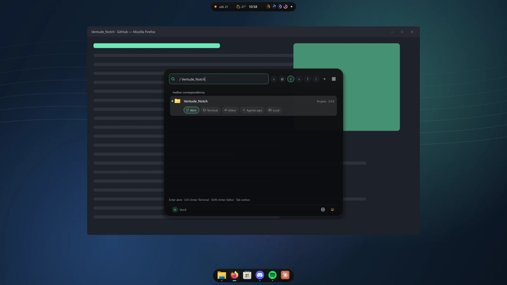
</p>
<p align="center">
  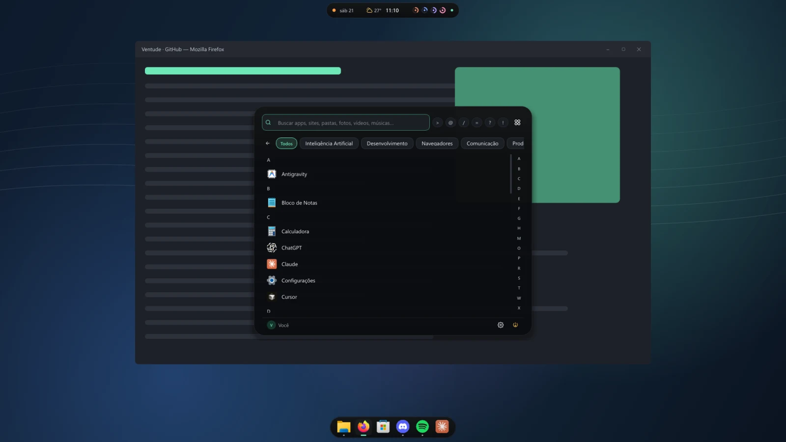
  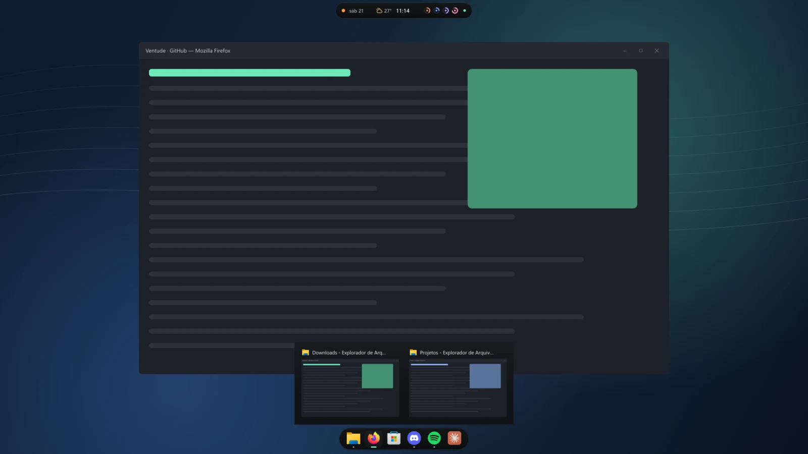
</p>
<p align="center">
  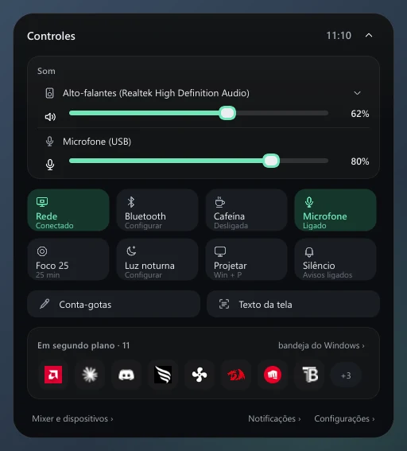
  
</p>

| Parte | O que faz |
|-------|-----------|
| **Doca flutuante** | Fixados e apps abertos numa cápsula centralizada, com prévias ao vivo das janelas, arrastar para reordenar e **Win + 1..9** para alternar. Modos: esquivar janelas, sempre visível ou oculta. |
| **Lançador (`Win` / `Win + S`)** | Início, Pesquisa instantânea e Todos os apps numa só folha. Escopos: `>` comandos, `@` janelas abertas, `/` projetos e arquivos, `=` calculadora, `?` web, `!` energia. |
| **Controles (`Win + A`)** | Volume e saída de áudio, microfone, Cafeína, Conta-gotas, OCR, Foco, Silêncio, Luz noturna e apps em segundo plano, direto na ilha. |
| **Energia** | Desligar, reiniciar, suspender e bloquear com a animação "Até logo!" em todas as telas (Esc cancela) e uma saudação ao ligar. |

> [!TIP]
> O Shell é opcional e seguro: a barra de tarefas do Windows volta ao desligá-lo, ao fechar o Ventude, em qualquer erro e até depois de um fechamento forçado.

## Limites das IAs

O Ventude lê os limites direto das contas que você já usa e nunca altera seus logins.

| IA | De onde lê | O que você precisa fazer |
|----|-----------|--------------------------|
| **Claude** | Login do **Claude Code**: sessão de 5h, semana e limites por modelo (os números do `/usage`). | Nada, se usa o Claude Code. Usando só o app ou o site, cole a `sessionKey` do claude.ai em **Ajustes > Claude**. |
| **Gemini (Antigravity)** | Servidor local do **Antigravity**: cota de cada modelo, agrupada por família. | Deixar o Antigravity aberto e logado. |
| **Codex (ChatGPT)** | Login do **Codex**: janela de 5h e semanal do plano. | Ligar em Ajustes. Sem o Codex, colar o cURL do chatgpt.com. |
| **Cursor** | Login do **Cursor** instalado: uso incluído no ciclo. | Ligar em Ajustes. Sem o Cursor, colar o cookie do cursor.com. |
| **GitHub Copilot** | Login da extensão do **Copilot**: requisições premium, chat e autocompletar do mês. | Ligar em Ajustes. Sem a extensão, colar um token `ghu_…`. |
| **Grok** | Login do **Grok CLI** ou cookie do **grok.com**: o limite semanal do plano, o mesmo da tela **Utilização** do site. | Colar o "Copiar como cURL" (ou o cookie) do grok.com em **Ajustes > Grok**. |

<details>
<summary><b>Como copiar o cookie ou o cURL do navegador</b></summary>

- **sessionKey do claude.ai**: F12 > Aplicativo (Application) > Cookies > `https://claude.ai` > copie o valor de `sessionKey`.
- **"Copiar como cURL"** (claude.ai, grok.com, chatgpt.com): F12 > Rede (Network) > atualize a página > botão direito numa requisição para o site > Copiar > **Copiar como cURL**. Funciona com as versões bash, cmd e PowerShell.

Esses valores ficam protegidos pelo Windows (DPAPI): só a sua conta do Windows consegue lê-los. Como o claude.ai e o grok.com ficam atrás do Cloudflare, o Ventude conversa com eles com uma conexão igual à do Chrome (`curl_cffi`).

</details>

> [!IMPORTANT]
> Os endpoints de uso do Claude, do Antigravity e do grok.com não são APIs públicas documentadas. Se um deles mudar, o card daquela IA mostra o aviso e o último valor conhecido, e o resto do Ventude continua funcionando.

## Privacidade e dados

- Nada é enviado para servidores do Ventude: não existem servidores do Ventude.
- Tudo fica em `%APPDATA%\Ventude` (`ventude.db` com ajustes e segredos protegidos e `ventude.log`, rotativo de 1 MB).
- Para remover, desinstale pelo Windows e apague essa pasta.

## Atalhos úteis

| Atalho | Ação |
|--------|------|
| `Ctrl + Alt + Espaço` | Abre e fecha a ilha |
| `Win` / `Win + S` | Lançador e Pesquisa (com o Shell ligado) |
| `Win + A` | Controles |
| `Win + 1..9` | Alterna os apps da Doca |
| `Ctrl + K` | Barra de comandos |
| `Ctrl + 1..9` / `Ctrl + ,` | Troca de aba / Ajustes |

---

## Para desenvolvedores

Requer **Python 3.12+** e [uv](https://docs.astral.sh/uv/).

```powershell
git clone https://github.com/3Gb3/Ventude.git
cd Ventude
uv sync
uv run ventude
```

```powershell
uv run ruff check                          # lint
uv run pytest                              # testes
uv run python scripts/preview.py preview   # capturas de todas as telas com dados de demonstração
```

Toda alteração na `main` gera uma versão nova automaticamente pelo GitHub Actions. Mais detalhes em [docs/ARCHITECTURE.md](docs/ARCHITECTURE.md) e [docs/PACKAGING.md](docs/PACKAGING.md).

## Contribuindo

Encontrou um bug ou tem uma ideia? [Abra uma issue](https://github.com/3Gb3/Ventude/issues). Pull requests são bem-vindos.

Se o Ventude te ajudou, deixe uma ⭐ no repositório e compartilhe com quem também vive de olho nos limites das IAs.

## Licença

Distribuído sob a [licença MIT](LICENSE): use, modifique e redistribua à vontade, mantendo o aviso de copyright.

<div align="center">
<sub>Feito no Brasil 🇧🇷 para o Windows.</sub>
</div>
