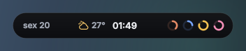
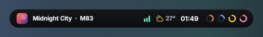
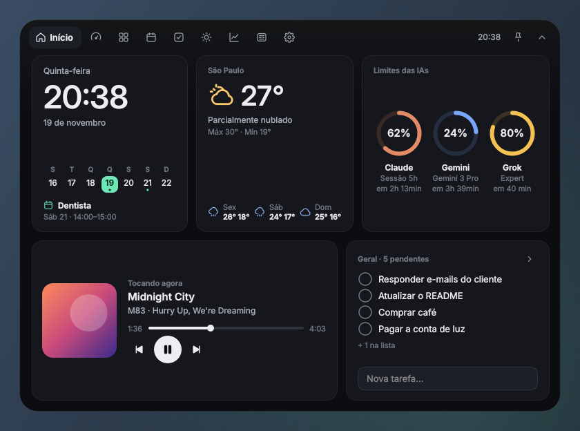
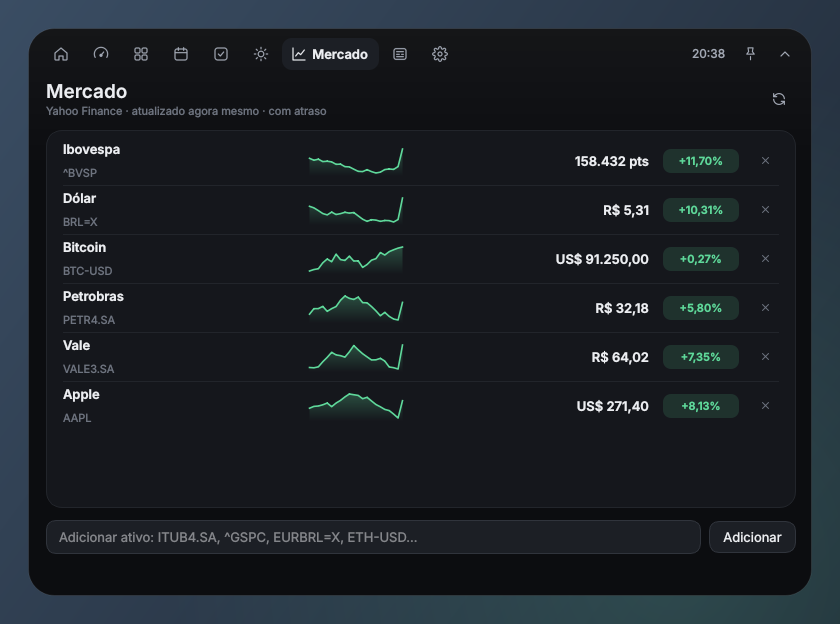

# Ventude

Uma Dynamic Island leve para Windows 10 e 11. Fica no topo da tela como uma pílula discreta, mostra a hora, a música tocando e **quanto ainda resta dos seus limites no Claude, no Gemini (Antigravity) e no Grok**. Passe o mouse para abrir o painel completo.

<p align="center">
  
  
</p>
<p align="center">
  
  
</p>
<p align="center">
  
  
  
</p>

## O que tem

| Aba | O que faz |
|-----|-----------|
| **Início** | Relógio, semana, próximo compromisso, clima, anéis das IAs, player e tarefas pendentes. |
| **IAs** | Limites de cada IA, janela por janela, com porcentagem usada e quando renova. |
| **Atalhos** | Apps, pastas, arquivos e sites a um clique. Arraste do Explorer para fixar. |
| **Agenda** | Calendário do mês e compromissos do dia (`14:00`, `14h`, `9-10`). |
| **Tarefas** | Listas rápidas: marque, edite com dois cliques e limpe as concluídas. |
| **Clima** | Agora e próximos 7 dias, pelo Open-Meteo (sem chave). |
| **Mercado** | Sua lista de ações, índices, moedas e cripto, com gráfico do mês (Yahoo Finance). |
| **Notícias** | G1, BBC Brasil e Tecnoblog, com filtro por fonte. |
| **Ajustes** | Tudo salvo na hora. Desligue as abas que não usa: elas somem e param de rodar. |

Também tem:

- Player do Windows (Spotify, YouTube, qualquer app) com capa, avanço e controles.
- Avisos na bandeja quando uma IA chega a 80% e 95% e quando o limite renova.
- Atalho global **Ctrl + Alt + Espaço** para abrir e fechar.
- A ilha some sozinha em tela cheia (jogos, vídeos, apresentações).
- Funciona em vários monitores: arraste a ilha para onde quiser.
- Iniciar com o Windows e uma só instância aberta por vez.

## Limites das IAs

O Ventude lê os limites direto das contas que você já usa. Nada passa por servidores de terceiros e ele nunca altera seus logins.

| IA | Como lê | O que você precisa fazer |
|----|---------|--------------------------|
| **Claude** | Usa o login do **Claude Code** (`%USERPROFILE%\.claude\.credentials.json`) para ler a sessão de 5h, a semana e os limites por modelo, os mesmos números do `/usage`. | Nada, se você usa o Claude Code logado. Se usa só o site, cole a `sessionKey` do claude.ai em **Ajustes > Claude**. |
| **Gemini (Antigravity)** | Conversa com o servidor local do **Antigravity** (127.0.0.1) e lê a cota de cada modelo (Gemini 3 Pro, Flash e os outros). | Deixe o Antigravity aberto e logado. Com ele fechado, a ilha mostra o último valor e já considera as renovações. |
| **Grok** | Usa o login do **Grok CLI** (`%USERPROFILE%\.grok\auth.json`) para ler os créditos do ciclo, ou o cookie do **grok.com** para ler as consultas restantes de cada modo (Auto, Rápido, Expert). | Se usa o site ou o app, cole o cookie do grok.com em **Ajustes > Grok**. |

Como pegar os valores do navegador (F12):

- **sessionKey do claude.ai**: F12 > Aplicativo (Application) > Cookies > `https://claude.ai` > copie o valor de `sessionKey`.
- **Cookie do grok.com**: F12 > Rede (Network) > clique em qualquer requisição para grok.com > Cabeçalhos > copie o valor inteiro de `Cookie`.

Esses segredos ficam protegidos pelo Windows (DPAPI): só a sua conta do Windows consegue lê-los.

> Os endpoints de uso do Claude, do Antigravity e do grok.com não são APIs públicas documentadas. Se um deles mudar, o card daquela IA mostra o aviso e o último valor conhecido, e o resto do Ventude continua funcionando.

## Instalar

Baixe o **`Ventude-Setup.exe`** da [última versão](https://github.com/3Gb3/Ventude_Notch/releases/latest) e abra. Ele instala sem pedir administrador (em `%LOCALAPPDATA%\Programs\Ventude`), cria o atalho na **área de trabalho** e no menu Iniciar e já abre o Ventude.

> O Windows pode avisar "O Windows protegeu o PC" porque o instalador não é assinado: clique em **Mais informações > Executar assim mesmo**.

### Atualizações

Toda alteração na branch `main` gera uma versão nova (`1.0.N`) automaticamente. Ao **iniciar**, o Ventude instalado confere se há uma versão mais nova e pergunta se você quer atualizar. Se aceitar, ele baixa, confere o arquivo, instala em silêncio e reabre sozinho. Ele não procura atualizações enquanto está aberto.

## Rodar pelo código-fonte

Requer Python 3.12+ e [uv](https://docs.astral.sh/uv/).

```powershell
uv sync
uv run ventude
```

Rodando pelo código, o Ventude não se atualiza sozinho: use `git pull`.

## Como usar

- **Passe o mouse** na ilha para abrir. Saiu com o mouse, ela fecha (o tempo é ajustável).
- **Clique** na ilha para abrir, mesmo com a abertura por mouse desligada.
- **Arraste** a pílula ou o topo do painel para mover, inclusive para outro monitor.
- **Esc** fecha. **Ctrl + 1…9** troca de aba. O **alfinete** mantém o painel aberto.
- **Bandeja**: clique para abrir e fechar. Clique com o botão direito para ocultar a ilha, trocar de monitor, atualizar os limites ou sair.

## Dados

Tudo fica em `%APPDATA%\Ventude`:

| Arquivo | Conteúdo |
|---------|----------|
| `ventude.db` | Ajustes, atalhos, agenda, tarefas, cache e segredos protegidos |
| `ventude.log` | Log rotativo (1 MB) |
| `legado\` | Arquivos da versão anterior, já migrados. Pode apagar. |

Na primeira execução, atalhos, compromissos e listas da versão antiga são migrados sozinhos. Os arquivos da IA antiga (`assistant.db`, `credentials.bin`) vão para `legado\` e não são mais usados.

## Desenvolvimento

```powershell
uv run ruff check
uv run pytest
uv run python scripts/preview.py preview
```

O `preview.py` gera capturas de todas as telas com dados de demonstração, sem tocar nos seus dados.

Detalhes em [docs/ARCHITECTURE.md](docs/ARCHITECTURE.md) e [docs/PACKAGING.md](docs/PACKAGING.md).
