# Ventude

Uma Dynamic Island e um **shell próprio** para Windows 10 e 11. No topo, uma pílula discreta mostra a hora, a música tocando e **quanto ainda resta dos seus limites no Claude, no Gemini (Antigravity), no Grok, no Codex (ChatGPT), no Cursor e no GitHub Copilot**; passe o mouse para abrir o painel completo. Embaixo, desde a 2.0, o **Ventude Shell** substitui a barra de tarefas, o Menu Iniciar e a Pesquisa do Windows.

## Ventude Shell (2.0)

<p align="center">
  
</p>
<p align="center">
  
  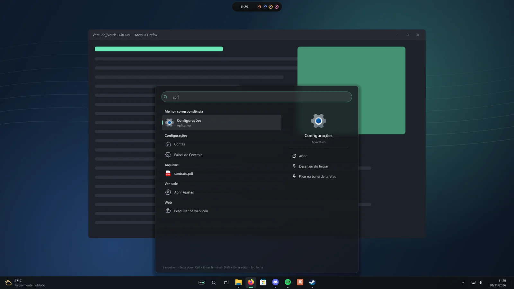
</p>
<p align="center">
  
  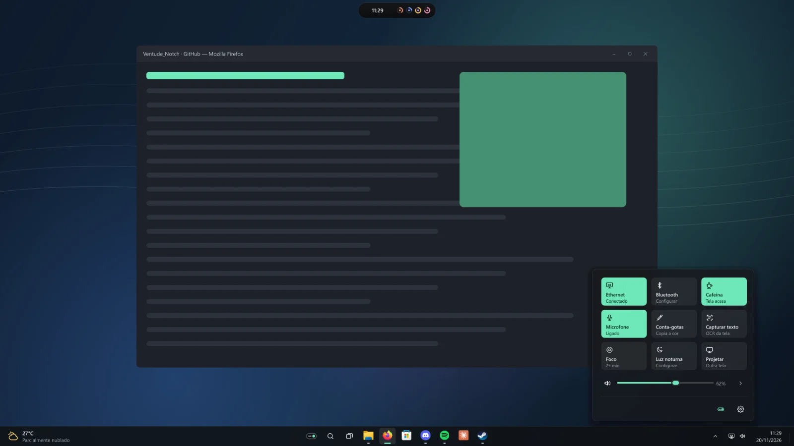
</p>
<p align="center">
  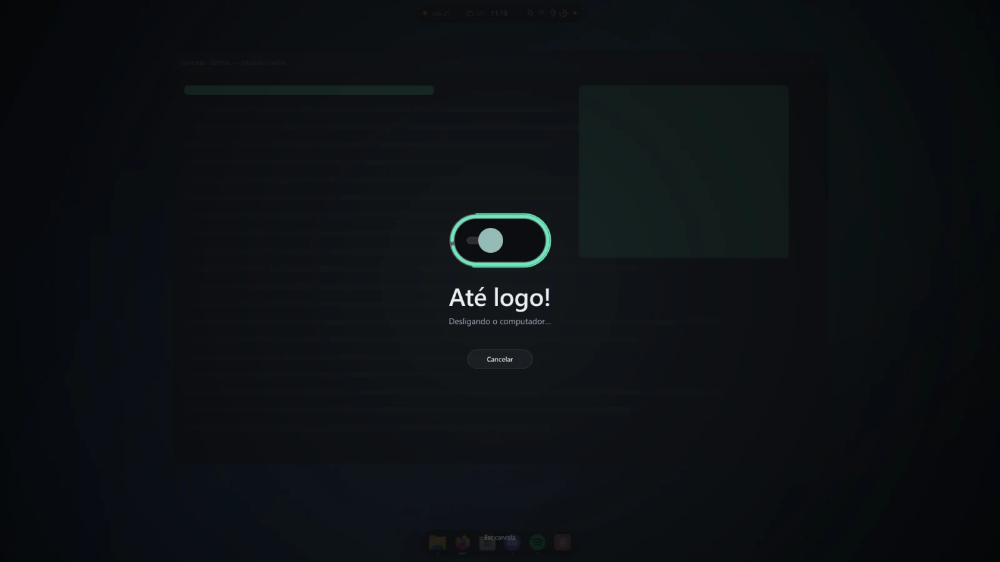
  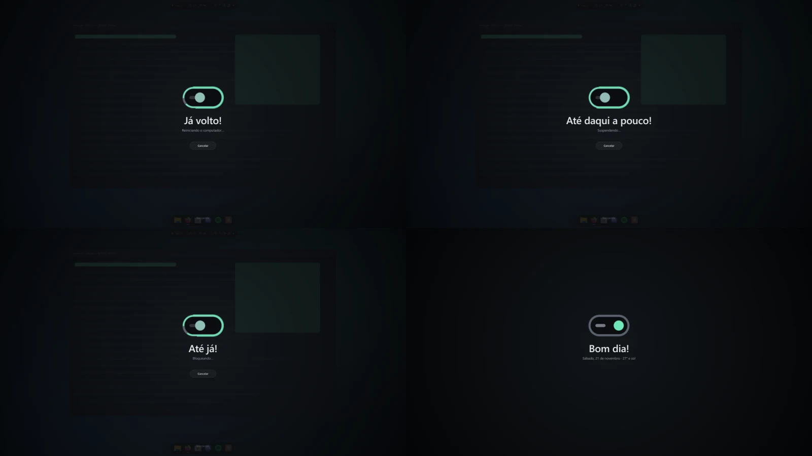
</p>

| Parte | O que faz |
|-------|-----------|
| **Barra de tarefas** | Clima à esquerda (com aviso de chuva). No centro: Iniciar (logo do Ventude), Pesquisa, Visão de tarefas, apps fixados e janelas abertas agrupadas como no Windows, com o ícone real do app. Traço curto = aberto, traço longo verde = em foco. Clique foca/minimiza, clique do meio abre outra janela, parar o mouse mostra **prévias ao vivo** das janelas (com fechar), e o ícone "pula" enquanto o app abre. À direita: ícones ocultos da bandeja, rede/volume/bateria (roda do mouse muda o volume), relógio com data e o cantinho de mostrar a área de trabalho. Uma barra por monitor; some em tela cheia; dá para alinhar à esquerda e ocultar automaticamente (botão direito na barra). |
| **Menu Iniciar** | Campo de pesquisa, **Fixado** (botão direito: desafixar, mover para o início, fixar na barra, abrir local, executar como administrador), **Recente** (o que você abriu e os arquivos recentes do Windows) e **Todos** por Categoria, Grade ou Lista. Rodapé com sua foto e nome (bloquear, sair, conta), Ajustes, Explorador e **Energia**. |
| **Pesquisa** | **Tecla Windows** (e Win + S) abre a Pesquisa do Ventude. Vazia, mostra as **Pesquisas recentes** (com o X para tirar). Ao digitar: Melhor correspondência + Apps, Configurações do Windows, Pastas, Arquivos, comandos do Ventude e "Pesquisar na web", com um painel de ações (Abrir, Executar como administrador, Abrir local, Fixar no Iniciar/na barra, Terminal e editor nas pastas). Calculadora, `t:` tarefa, `a:` compromisso, `timer`, `qr`, `cafeina`, `/p pasta` continuam valendo. |
| **Painel rápido** | Rede (Wi-Fi/Ethernet), Bluetooth, Cafeína, Microfone, Conta-gotas, Capturar texto (OCR), Foco (Pomodoro), Luz noturna e Projetar; volume com a escolha da saída de áudio. |
| **Calendário** | Mês com os dias que têm compromisso, a agenda do dia escolhido, "Abrir a Agenda" e Foco de 25 min. |
| **Energia com animação** | Desligar, reiniciar, suspender, hibernar, bloquear e sair escurecem **todas as telas** e mostram uma despedida ("Até logo!", "Já volto!", "Até daqui a pouco!", "Até já!") com uma linha de contagem; **Esc** ou "Cancelar" desistem. Bloquear/suspender: a cortina some sozinha depois. Ao ligar o PC: "Bom dia, Fulano!" com a data e o clima. |

A ilha ficou mais enxuta no Shell: energia, cafeína, conta-gotas e OCR moram no Iniciar e no painel rápido; data e clima foram para a barra (dá para voltar em Ajustes). Digitar com a ilha aberta (ou Ctrl + K) abre a Pesquisa do Ventude.

**Segurança da barra do Windows**: ela volta ao desligar o Shell (Ajustes > Ventude Shell, menu da bandeja ou botão direito na barra > "Voltar para a barra do Windows"), ao fechar o Ventude, em qualquer erro e, se o Ventude for fechado à força, na próxima abertura. A tecla Windows também é sempre solta. Os ícones da bandeja de outros apps ficam no "^" (clique abre o app) e o botão "Bandeja do Windows" mostra a barra original por alguns segundos.

## A ilha

<p align="center">
  
  
  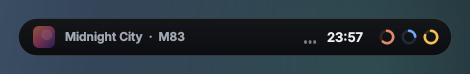
</p>
<p align="center">
  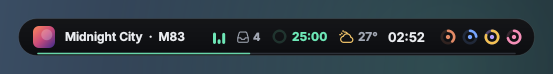
  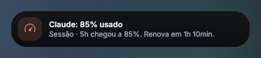
</p>
<p align="center">
  
  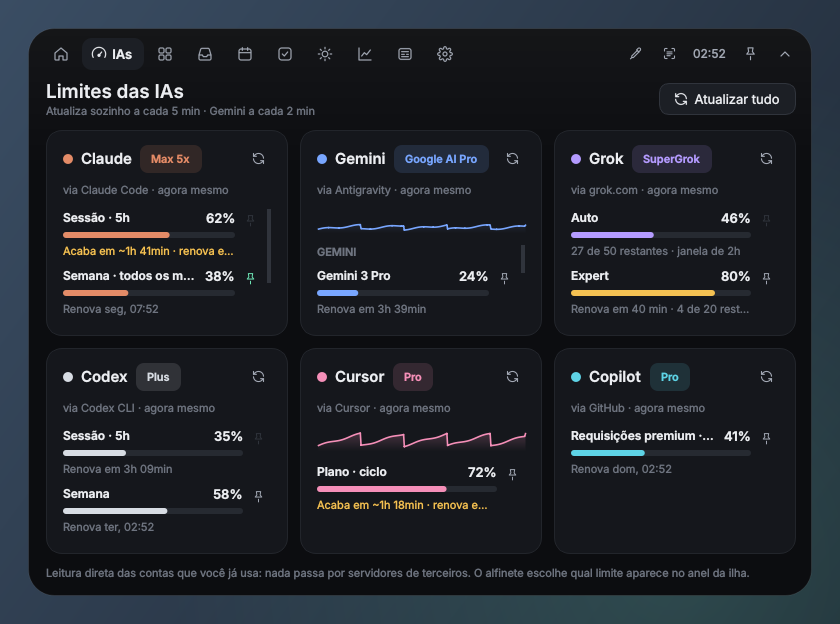
</p>
<p align="center">
  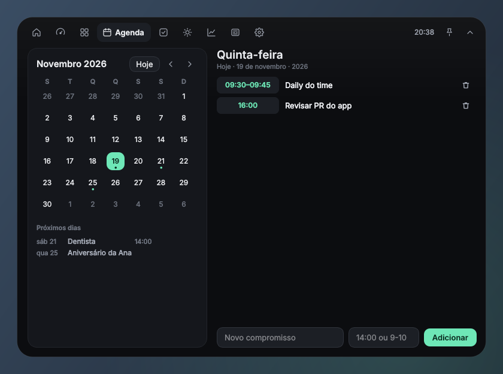
  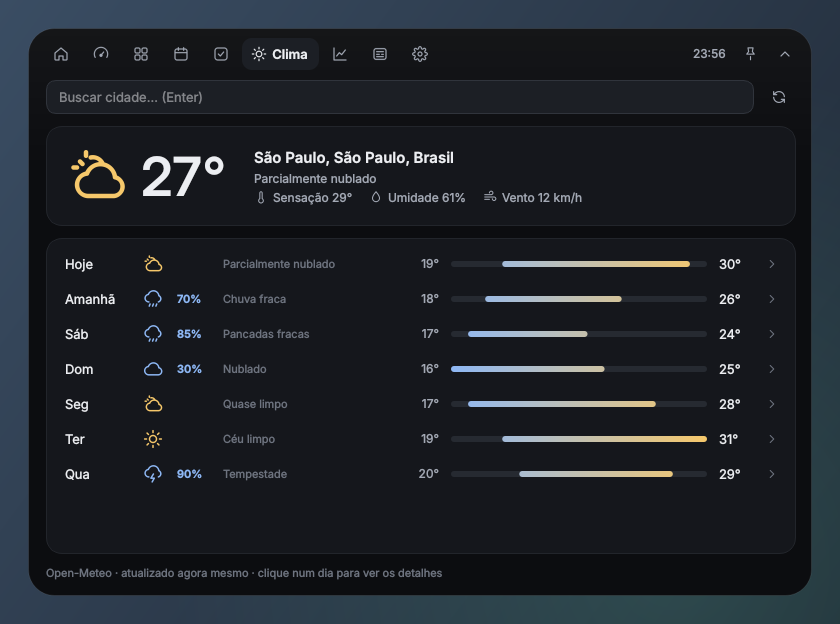
  
</p>
<p align="center">
  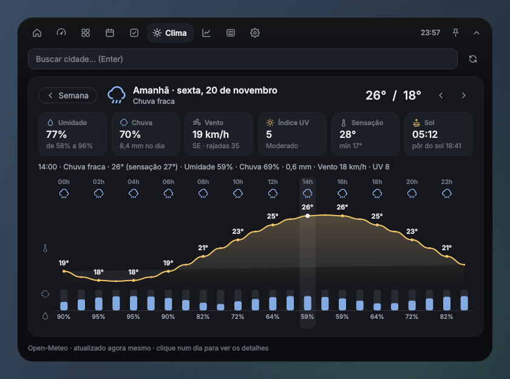
  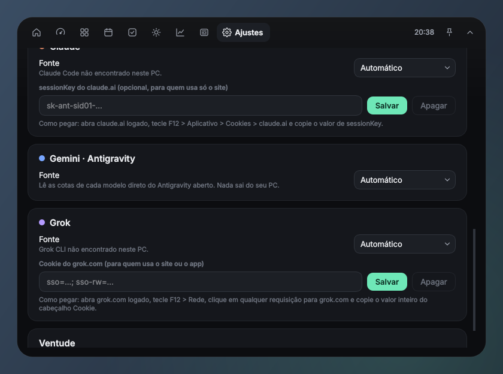
</p>
<p align="center">
  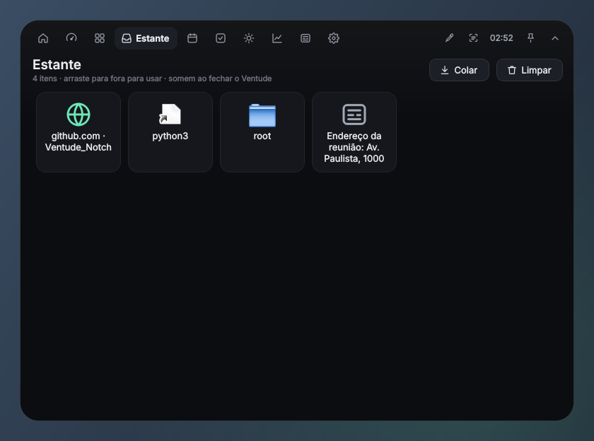
  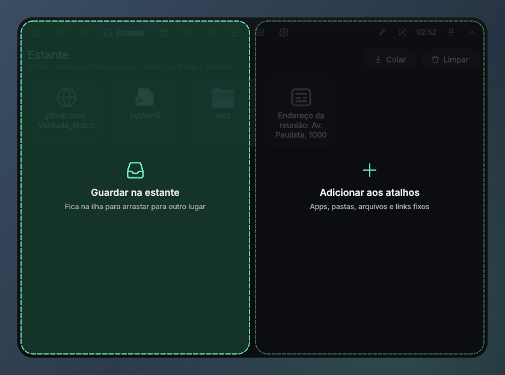
  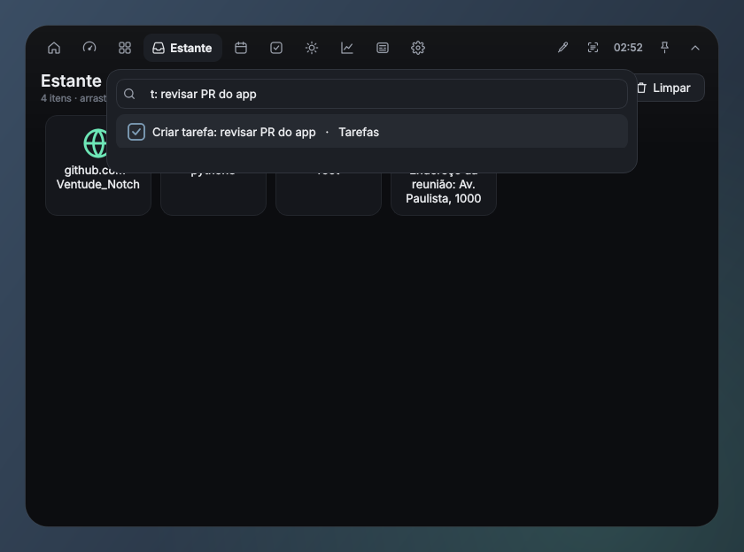
</p>

## O que tem

| Aba | O que faz |
|-----|-----------|
| **Início** | Relógio, semana, próximo compromisso, clima, anéis das IAs, player e tarefas pendentes. |
| **IAs** | Limites de cada IA, janela por janela (no Gemini, modelo por modelo, agrupados por família), com porcentagem usada e quando renova. O alfinete escolhe qual limite vai no anel da ilha. |
| **Sistema** | CPU (com os processos que mais usam), GPU (uso, VRAM, temperatura e consumo nas NVIDIA), RAM, rede (download, upload e ping), disco e bateria ao vivo, com gráfico do último minuto. O alfinete fixa a métrica na ilha fechada. |
| **Áudio** | Troca a saída (fones, caixas, HDMI, Bluetooth) e o microfone padrão com 1 clique, volume master e do microfone e mixer por aplicativo, com o ícone de cada app. |
| **Estante** | Guarda arquivos, imagens, links, textos e cores soltos na ilha e (com o histórico ligado) os últimos 20 que você copiou. Filtro Tudo/Copiados/Fixados, QR Code de textos e links e fixar para não sumir ao fechar. |
| **Atalhos** | Apps, pastas, arquivos e sites a um clique. Arraste do Explorer para a ilha, mesmo fechada: ela abre nos Atalhos. |
| **Agenda** | Calendário do mês e compromissos do dia (`14:00`, `14h`, `9-10`). Avisa na ilha 10 e 5 minutos antes. |
| **Tarefas** | Listas rápidas: marque, edite com dois cliques e limpe as concluídas. |
| **Clima** | Agora e próximos 7 dias, pelo Open-Meteo (sem chave). Clique num dia para ver umidade, chuva, vento, UV, nascer e pôr do sol e o gráfico hora a hora. |
| **Mercado** | Sua lista de ações, índices, moedas e cripto, com gráfico do mês (Yahoo Finance). |
| **Notícias** | G1, BBC Brasil e Tecnoblog, com filtro por fonte. |
| **Ajustes** | Tudo salvo na hora. Desligue as abas que não usa: elas somem e param de rodar. Escolha quais IAs ficam ligadas, quais têm anel na ilha e qual limite cada anel mostra. |

Também tem:

- Clima de agora (ícone e temperatura) na ilha fechada, com aviso de chuva na próxima hora. Sem cidade escolhida, ele estima pelo IP.
- **Na ilha fechada**: clique nos anéis abre a aba IAs, no clima abre o Clima, na data abre a Agenda, nas métricas abre o Sistema. Clique do meio ou na capa toca/pausa, a roda do mouse muda o volume do Windows (e mostra o valor na ilha) e Shift + roda troca de faixa. Uma linha fina mostra o andamento da música.
- **Avisos na própria ilha**: limites das IAs, música nova e lembretes da Agenda aparecem por alguns segundos e somem.
- **Timer e Pomodoro** pelo Início ou pela barra de comandos, com a contagem na ilha e um pulso ao terminar.
- **Barra de comandos** (atalho global, Ctrl + K ou começar a digitar): abre atalhos, cria tarefas (`t: revisar PR`), compromissos (`a: call 15h`, `a: dentista amanhã 9h-10h`) e timers (`timer 15m`, `pomodoro`).
- **Conta-gotas** (copia a cor em HEX) e **captura de texto** (OCR do próprio Windows) no topo do painel.
- **Busca universal**: apps instalados (inclusive da Loja), pastas e arquivos do usuário. Pasta: Enter abre no Explorer, Ctrl + Enter abre o Terminal nela e Shift + Enter abre no Cursor/VS Code. `/p nome` busca só pastas, `1450 * 5,85` calcula e copia, `qr texto` mostra um QR Code. No Shell, é a tela de Pesquisa; sem ele, a barra de comandos da ilha.
- **Tecla Windows** (Ajustes > Ventude Shell): Win sozinha e Win + S abrem a Pesquisa do Ventude; os outros atalhos com Win continuam do Windows.
- **Energia**: bloquear, suspender, hibernar, reiniciar, desligar, sair da sessão e, com atualização do Windows pendente, atualizar e reiniciar/desligar. No Shell, pelo Iniciar, sempre com a animação "Até logo!" (dá para cancelar); sem o Shell, no topo do painel.
- **Modo Cafeína** (xícara no topo do painel ou `cafeina 2h`): o Windows não apaga a tela nem suspende.
- **Privacidade na ilha**: ponto laranja com o microfone em uso, verde com a câmera, com o nome do app. Clique no laranja muta o microfone.
- **Letra sincronizada** da música no Início (lrclib.net).
- Player do Spotify com capa, avanço e controles; pausado, a música continua na ilha. Em **Ajustes > Música** dá para seguir qualquer player do Windows.
- Abre na hora ao passar o mouse (o tempo é ajustável) e troca de aba com animação.
- Avisos na bandeja quando uma IA chega a 80% e 95% e quando o limite renova.
- Atalho global **Ctrl + Alt + Espaço** para abrir e fechar.
- A ilha some sozinha em tela cheia (jogos, vídeos, apresentações).
- Funciona em vários monitores: arraste a ilha para onde quiser.
- Iniciar com o Windows e uma só instância aberta por vez.

## Limites das IAs

O Ventude lê os limites direto das contas que você já usa. Nada passa por servidores de terceiros e ele nunca altera seus logins.

| IA | Como lê | O que você precisa fazer |
|----|---------|--------------------------|
| **Claude** | Usa o login do **Claude Code** (`%USERPROFILE%\.claude\.credentials.json`, ou o do WSL com a distro aberta) para ler a sessão de 5h, a semana e os limites por modelo, os mesmos números do `/usage`. O token dura poucas horas: quando vence, o Ventude renova do mesmo jeito que o Claude Code faz e grava no mesmo arquivo (dá para desligar em Ajustes). | Nada, se você usa o Claude Code logado. Se usa o **Claude Desktop** ou o site, cole a `sessionKey` (ou o "Copiar como cURL") do claude.ai em **Ajustes > Claude**: o app usa a mesma conta, então pegue no navegador logado nela. |
| **Gemini (Antigravity)** | Conversa com o servidor local do **Antigravity** (127.0.0.1) e lê a cota de cada modelo (Gemini, Claude, GPT e os outros que ele oferecer), agrupados por família. O anel da ilha segue os modelos Gemini. | Deixe o Antigravity aberto e logado. Com ele fechado, a ilha mostra o último valor e já considera as renovações. |
| **Codex (ChatGPT)** | Usa o login do **Codex** (`%USERPROFILE%\.codex\auth.json`) para ler a janela de 5h e a semanal do seu plano do ChatGPT. | Ligue em **Ajustes > Limites das IAs**. Sem o Codex instalado, cole o "Copiar como cURL" do chatgpt.com. |
| **Cursor** | Lê o login que o **Cursor** instalado guarda no PC e mostra o uso incluído no plano por ciclo. Os modelos usados dentro do Cursor (Grok, Claude, GPT...) contam aqui. | Ligue em **Ajustes > Limites das IAs**. Sem o Cursor instalado, cole o cookie `WorkosCursorSessionToken` do cursor.com. |
| **GitHub Copilot** | Lê o login da extensão do **Copilot** (VS Code, Visual Studio, JetBrains) e mostra as requisições premium, o chat e o autocompletar do mês. | Ligue em **Ajustes > Limites das IAs**. Sem a extensão, cole um token `ghu_…`/`gho_…`. |
| **Grok** | Usa o login do **Grok CLI** (`%USERPROFILE%\.grok\auth.json`) para ler os créditos do ciclo, ou o cookie do **grok.com** para ler as consultas restantes de cada modo (Auto, Rápido, Expert). | Se usa o site, o app ou os bots, cole o "Copiar como cURL" (ou o cookie) do grok.com em **Ajustes > Grok**. O Grok usado dentro do Cursor conta no limite do Cursor, não no da conta Grok. |

Na aba IAs, cada IA mostra um mini-gráfico do uso nas últimas horas e avisa quando, no ritmo atual, o limite vai acabar antes de renovar ("Acaba em ~1h 40min"). Codex, Cursor e Copilot já instalados são ligados sozinhos na primeira abertura da 1.2 (ou pelo botão **Detectar IAs instaladas**).

Em **Ajustes > Limites das IAs**, uma tabela escolhe quais IAs ficam ligadas, quais ganham anel na ilha e no Início e **qual limite cada anel acompanha**: automático (o mais apertado), sessão de 5h, semana, um modelo específico... O alfinete na aba IAs faz o mesmo. Codex, Cursor e Copilot começam desligados.

O claude.ai e o grok.com ficam atrás do Cloudflare, que barra programas em Python comuns. O Ventude conversa com eles com uma conexão igual à do Chrome (biblioteca `curl_cffi`), e o cartão de cada IA mostra o motivo quando algo é recusado.

Como pegar os valores do navegador (F12):

- **sessionKey do claude.ai**: F12 > Aplicativo (Application) > Cookies > `https://claude.ai` > copie o valor de `sessionKey`.
- **"Copiar como cURL" (claude.ai ou grok.com)**: F12 > Rede (Network) > atualize a página > botão direito numa requisição para o site (no Grok, a `rate-limits`) > Copiar > **Copiar como cURL**. Vão juntos o cookie, o navegador usado e os cabeçalhos que o site pede. Funciona com as versões bash, cmd e PowerShell.

Esses segredos ficam protegidos pelo Windows (DPAPI): só a sua conta do Windows consegue lê-los.

> Os endpoints de uso do Claude, do Antigravity e do grok.com não são APIs públicas documentadas. Se um deles mudar, o card daquela IA mostra o aviso e o último valor conhecido, e o resto do Ventude continua funcionando.

## Instalar

Baixe o **`Ventude-Setup.exe`** da [última versão](https://github.com/3Gb3/Ventude_Notch/releases/latest) e abra. Ele instala sem pedir administrador (em `%LOCALAPPDATA%\Programs\Ventude`), cria o atalho na **área de trabalho** e no menu Iniciar e já abre o Ventude.

> O Windows pode avisar "O Windows protegeu o PC" porque o instalador não é assinado: clique em **Mais informações > Executar assim mesmo**.

### Atualizações

Toda alteração na branch `main` gera uma versão nova automaticamente. A primeira de cada linha é a versão do `pyproject.toml` (hoje **2.0.0**); as seguintes sobem só o último número (2.0.1, 2.0.2...). Ao **iniciar**, o Ventude instalado confere se há uma versão mais nova e pergunta se você quer atualizar. Se aceitar, ele baixa, confere o arquivo, instala em silêncio e reabre sozinho. Ele não procura atualizações enquanto está aberto.

## Rodar pelo código-fonte

Requer Python 3.12+ e [uv](https://docs.astral.sh/uv/).

```powershell
uv sync
uv run ventude
```

Rodando pelo código, o Ventude não se atualiza sozinho: use `git pull`.

## Como usar

- **Passe o mouse** na ilha para abrir (na hora, por padrão). Saiu com o mouse, ela fecha (os dois tempos são ajustáveis).
- **Arraste** apps, pastas, arquivos ou links para a ilha: ela abre nos Atalhos e adiciona ao soltar.
- **Clique** na ilha para abrir, mesmo com a abertura por mouse desligada.
- **Arraste** a pílula ou o topo do painel para mover, inclusive para outro monitor.
- **Esc** fecha. **Ctrl + 1…9** troca de aba e **Ctrl + 0** (ou **Ctrl + ,**) abre os Ajustes. O **alfinete** mantém o painel aberto.
- **Bandeja**: clique para abrir e fechar. Clique com o botão direito para ocultar a ilha, trocar de monitor, atualizar os limites ou sair.

## Dados

Tudo fica em `%APPDATA%\Ventude`:

| Arquivo | Conteúdo |
|---------|----------|
| `ventude.db` | Ajustes, atalhos, agenda, tarefas, cache e segredos protegidos |
| `ventude.log` | Log rotativo (1 MB) |
| `legado\` | Arquivos da versão anterior, já migrados. Pode apagar. |

Na primeira execução, atalhos, compromissos e listas da versão antiga são migrados sozinhos. Os arquivos da IA antiga (`assistant.db`, `credentials.bin`) vão para `legado\` e não são mais usados.

## Desenvolvimento

```powershell
uv run ruff check
uv run pytest
uv run python scripts/preview.py preview
```

O `preview.py` gera capturas de todas as telas com dados de demonstração, sem tocar nos seus dados. Com `--shell`, gera só as do Ventude Shell numa área de trabalho de 1920×1080 (inclusive a animação "Até logo!" em PNG animado).

Detalhes em [docs/ARCHITECTURE.md](docs/ARCHITECTURE.md) e [docs/PACKAGING.md](docs/PACKAGING.md).
